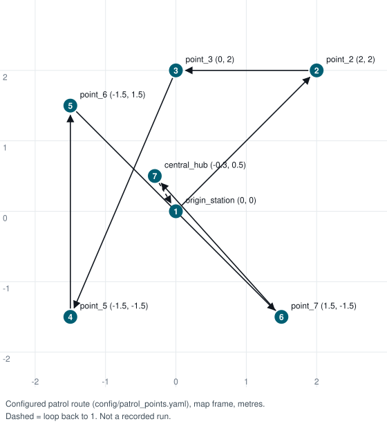

# ROS 2 Patrol Navigation

A TurtleBot3 (burger) patrols 7 waypoints in the Gazebo TurtleBot3 world with Nav2: waypoints, looping and retries come from `config/patrol_points.yaml`, and RViz markers show the waypoints, the patrol path and the current target. ROS 2 Humble, Python 3.10.


## Quick start

Requires Ubuntu 22.04, ROS 2 Humble with Nav2 and the TurtleBot3 packages, and Gazebo Classic 11 (`sudo apt install ros-humble-navigation2 ros-humble-nav2-bringup 'ros-humble-turtlebot3*'`).

```bash
mkdir -p ~/ros2_patrol_ws/src
git clone https://github.com/AungKaung1928/ros2-patrol-project.git ~/ros2_patrol_ws/src/patrol_navigation_project
cd ~/ros2_patrol_ws
rosdep install --from-paths src --ignore-src -r -y     # first time only
colcon build --packages-select patrol_navigation_project
```

Terminal 1, the simulator:

```bash
export TURTLEBOT3_MODEL=burger
ros2 launch turtlebot3_gazebo turtlebot3_world.launch.py
```

Terminal 2, about 30 s later (Nav2 + patrol; the robot starts driving the waypoints in order and loops):

```bash
cd ~/ros2_patrol_ws && source install/setup.bash
export TURTLEBOT3_MODEL=burger
ros2 launch patrol_navigation_project patrol_navigation.launch.py
```



The route as configured in `config/patrol_points.yaml` (drawn by `scripts/plot_route.py`; CI fails if the figure and the config disagree). The order crosses the arena centre three times: it is the configured order, not an optimised tour.

## How it works

- `patrol_controller.py` sends each waypoint as a Nav2 `NavigateToPose` goal, retries a failed goal up to `max_retries` (3), then moves on; `loop_enabled` restarts the round.
- `waypoint_manager.py` loads the YAML; `patrol_visualizer.py` publishes the RViz markers.
- Nav2 settings are in `config/nav2_params.yaml`.

A goal canceled from outside the node (another Nav2 client, RViz) ends the patrol without a resume. Not measured: loop time, success rate and waypoint accuracy (no script records them).

More: project layout, configuration, adding waypoints, monitoring and troubleshooting in [docs/USAGE.md](docs/USAGE.md).

Test without Gazebo or Nav2: `cd src/patrol_navigation_project && launch_test test/test_launch_retry.py` (after `source install/setup.bash`) starts the installed node against a stand-in `navigate_to_pose` server that aborts the first goal, and checks the node retries the same point and then moves on to the next one. `test_launch_bounded_retry.py` (skip after `max_retries`) and `test_launch_no_loop.py` (`loop_enabled: false` stops after the last point) are the same tests the C++ port runs. CI runs all three in `ros:humble` on every push.

## License

Apache-2.0, see LICENSE.
